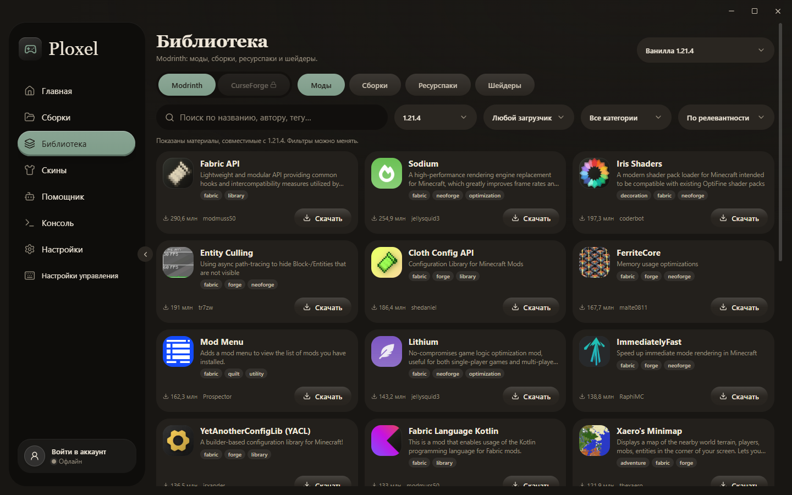

# Ploxel

**Лаунчер Minecraft: Java Edition, в котором с первой минуты понятно, где что находится.**
Создавайте и настраивайте сборки, ставьте моды, рисуйте скин и настраивайте сам лаунчер под себя — без рекламы, доната и телеметрии.


> **Бета.** Ploxel работает и готов к игре, но пока без двух функций: каталога модов CurseForge и входа через аккаунт Microsoft.
> Для них нужны ключ API CurseForge и одобрение приложения со стороны Mojang. Обе заявки в работе; код под эти функции уже написан, и как только доступ появится, выйдет обновление.

## Скачать

Последняя версия — на странице [Releases](../../releases/latest): файл `Ploxel-Setup-1.0.0.exe`.

- Система: Windows 10/11, 64-bit.
- Установщик пока не подписан цифровой подписью, поэтому Windows SmartScreen может показать предупреждение. Нажмите «Подробнее» → «Выполнить в любом случае».
- Проверить, что файл не подменён: в PowerShell выполните `Get-FileHash .\Ploxel-Setup-1.0.0.exe` и сравните с SHA-256 из описания релиза.

## Возможности

**Сборки и моды**
- Сборка создаётся за пару кликов: версия игры (включая снапшоты), загрузчик Fabric, Forge, NeoForge или Quilt. Загрузчик и нужная Java ставятся сами.
- Каждая сборка изолирована: свои моды, конфиги, миры и настройки.
- Каталог Modrinth прямо в лаунчере: моды, модпаки, ресурспаки и шейдеры. Поиск понимает русский язык и опечатки, зависимости докачиваются автоматически.
- «Проверка сборки» находит недостающие зависимости, конфликты, дубликаты и моды не под ту версию игры и исправляет то, что вы отметите.
- Импорт сборок из 16 лаунчеров (официальный, Prism, MultiMC, CurseForge, Modrinth App, TLauncher, XMCL и другие), экспорт в `.mrpack` и CurseForge `.zip`.

**ИИ-помощник** *(со своим ключом, см. ниже)*
- «Подобрать с ИИ»: опишите, какую сборку хотите, выберите загрузчик, версию и количество модов. ИИ предложит моды, ресурспаки и шейдеры карточками, вы снимете лишнее, и лаунчер соберёт сборку. Оптимизация под выбранную версию добавляется сама.
- «Улучшить с ИИ»: ИИ получает список модов вашей сборки и добавляет то, что вы попросите.
- Разбор падений игры: лаунчер объясняет ошибку простыми словами. Лог перед отправкой очищается от ника, путей и токенов, и вы видите его до отправки.

**Скины**
- Встроенный редактор скина и 3D-просмотр с объёмным вторым слоем (как в моде 3D Skin Layers).
- Скин сам подстраивается под тонкие и широкие руки.

**Оформление и удобство**
- 7 тем со светлым и тёмным вариантом, своя «Кастомная» тема, акценты, градиенты, 6 анимированных фонов, 15 шрифтов.
- 13 языков интерфейса.
- Обучение при первом запуске и 37 гайдов: от первого запуска до настройки памяти, Java и шейдеров.
- Загрузки в фоне с прогрессом в боковом меню, ограничение скорости, перенос папки с игрой на другой диск.




## ИИ: что нужно знать

Своего ИИ-сервиса у Ploxel нет: оплачивать запросы за всех пользователей я пока не могу. Подключите любой OpenAI-совместимый сервис в «Настройки → ИИ-помощник»:
- бесплатно и без интернета — локальная модель через **LM Studio** или **Ollama**;
- или облачный сервис (OpenAI, OpenRouter, Groq и др.) со своим ключом.

Ключ хранится только на вашем компьютере в зашифрованном виде (Windows DPAPI). Без ключа все остальные функции лаунчера работают как обычно.

## Приватность

- Никакой телеметрии и аналитики.
- Аккаунты, ключи и настройки хранятся только у вас (`%APPDATA%\Ploxel`).
- Файлы скачиваются только с официальных адресов: Mojang, Modrinth, Adoptium.
- Кнопка «Перевод» на странице мода отправляет в Google Translate только текст описания мода.

## Частые вопросы

**Чем Ploxel отличается от других лаунчеров?**
Каждый лаунчер хорош по-своему. В Ploxel я постарался совместить простой и понятный интерфейс для новичка с инструментами, которые пригодятся и опытному игроку. Если для вас это важно — попробуйте.

**Он скопирован с других лаунчеров?**
Нет. Часть идей подсмотрена у других лаунчеров, особенно у XMCL: подбор сборки с ИИ, гибкая настройка загрузок, импорт сборок, разбор ошибок и поиск неисправностей в сборке. Реализация своя.

**Как он сделан?**
Лаунчер написан с помощью Claude Opus 5.5. Ранние версии тестировали мои знакомые.

**Он полностью готов?**
Нет, ему ещё есть куда расти. Но основное работает: можно создать сборку, поставить моды, запустить игру и играть.

**Где официальные версии?**
Только на этой странице GitHub. В других местах выкладывать Ploxel я пока не планирую. Если встретите его где-то ещё, это не мой файл.

**Лаунчер «чистый»?**
Да. Весь исходный код открыт в этом репозитории, установщик собирается из него же. Контрольная сумма каждого установщика указана в описании релиза.

## Сборка из исходников

Нужен [Node.js 22+](https://nodejs.org).

```powershell
npm install    # зависимости (один раз)
npm run dev    # запуск в режиме разработки
npm run dist   # установщик — появится в dist\installer
```

Ключи API (Microsoft, CurseForge, ИИ) в код не встроены: они берутся из `config.json` рядом с приложением или из переменных окружения. Пример — в `config.example.json`.

## Лицензия

[MIT](LICENSE). Ploxel — неофициальный проект, он не связан с Mojang Studios и Microsoft. Minecraft — товарный знак Mojang Synergies AB.
