<div align="center">


# Ploxel

[](../../releases/latest)

[](LICENSE)

[Скачать](#скачать) · [Вкладки](#вкладки-лаунчера) · [ИИ](#ии-что-нужно-знать) · [Приватность](#приватность) · [Вопросы](#частые-вопросы) · [Сборка из исходников](#сборка-из-исходников)

</div>

---

**Ploxel — удобный и понятный лаунчер Minecraft: Java Edition, в котором есть всё нужное, чтобы гибко настроить игру под себя.** С первой минуты ясно, где что находится, а возможностей хватит и новичку, и опытному игроку.

Он создаёт и запускает сборки на любой версии игры с **Fabric, Forge, NeoForge или Quilt**. Моды, модпаки, ресурспаки, шейдеры, датапаки и миры ставятся из каталогов **Modrinth и CurseForge** прямо в лаунчере. Зависимости докачиваются сами, модпаки обновляются без переустановки, а «Поиск неисправностей» находит конфликты и дубликаты до того, как игра упадёт.

Ещё в Ploxel есть редактор скинов с 3D-просмотром, сервер для игры с друзьями в пару кликов и ИИ-помощник, который подбирает сборку и объясняет ошибки игры. Внешний вид лаунчера тоже меняется: темы, фоны, шрифты.

> [!NOTE]
> Рекламы, доната и телеметрии нет. Исходный код открыт.

<p align="center">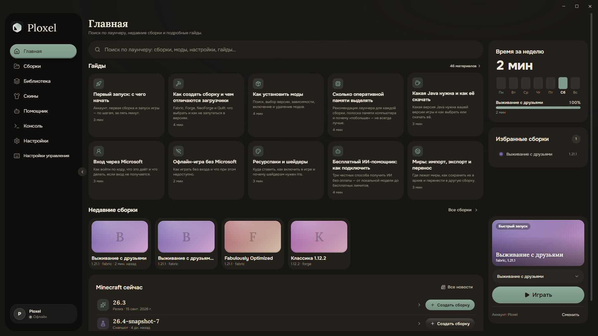</p>

## Скачать

Последняя версия — на странице [Releases](../../releases/latest): файл `Ploxel-Setup-<версия>.exe`.
Дальше лаунчер обновляется сам: при запуске он проверяет новые версии на этой странице и предлагает поставить их поверх. Сборки и настройки при этом сохраняются.

- **Система:** Windows 10/11, 64-bit.
- **Проверка файла:** в PowerShell выполните `Get-FileHash .\Ploxel-Setup-<версия>.exe` и сравните результат с SHA-256 из описания релиза.

> [!TIP]
> Установщик пока не подписан цифровой подписью, поэтому Windows SmartScreen может показать предупреждение. Нажмите «Подробнее» → «Выполнить в любом случае».

## Вкладки лаунчера

### Главная

Стартовая страница. Отсюда можно быстро запустить игру или найти что угодно в лаунчере.

- **Поиск по лаунчеру.** Ищет сборки, моды, настройки и гайды одновременно. Подсказки появляются, пока слово ещё не дописано. Поиск понимает:
  - опечатки;
  - перепутанную раскладку;
  - транслит («kak ustanovit shejdery»);
  - фразы своими словами («не запускается», «чёрный экран», «играть с другом»).
- **Гайды.** 46 подробных материалов: от первого запуска до памяти, Java, шейдеров, датапаков, входа в аккаунт и переноса миров.
- **Недавние сборки.** Сборки, в которые вы играли последними.
- **Minecraft сейчас.** Свежие релизы и снапшоты Mojang. Кнопка «Создать сборку» сразу делает сборку на этой версии.
- **Время за неделю.** Сколько вы играли в каждый день недели и в каких сборках.
- **Избранные сборки** и **быстрый запуск**: выберите сборку и нажмите «Играть». Здесь же видно, под каким аккаунтом запустится игра.

---

### Сборки

<p align="center">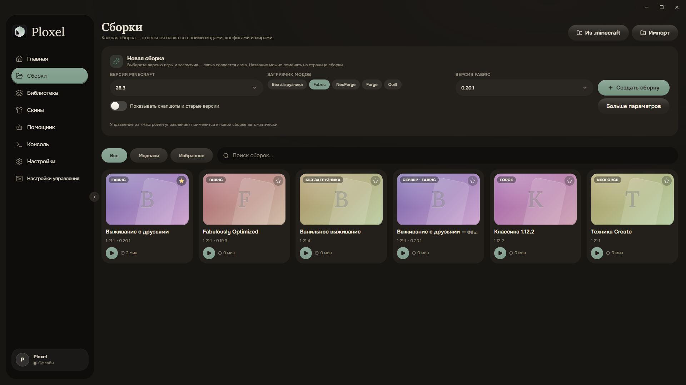</p>

Каждая сборка — отдельная папка со своими модами, конфигами, мирами и настройками. Сборки не мешают друг другу.

- **Новая сборка в одном блоке.** Выберите версию игры и загрузчик (без загрузчика, Fabric, NeoForge, Forge или Quilt) и нажмите «Создать сборку». Нужные загрузчик и Java лаунчер скачает сам при первом запуске, а ход установки видно в карточке загрузок.
- **«Больше параметров».** Название, память и своя Java для новой сборки.
- **Импорт.** Сборки переносятся из 16 лаунчеров: официального, Prism, MultiMC, CurseForge, Modrinth App, TLauncher, XMCL и других. Также можно открыть модпак `.mrpack` или CurseForge `.zip`. Кнопка «Из .minecraft» забирает моды и миры из обычной папки игры.
- **Фильтры и поиск.** «Все», «Модпаки», «Избранное» и поиск по названию. Сборки-серверы помечены значком «Сервер».

**Страница сборки** открывается кликом по карточке:

<p align="center">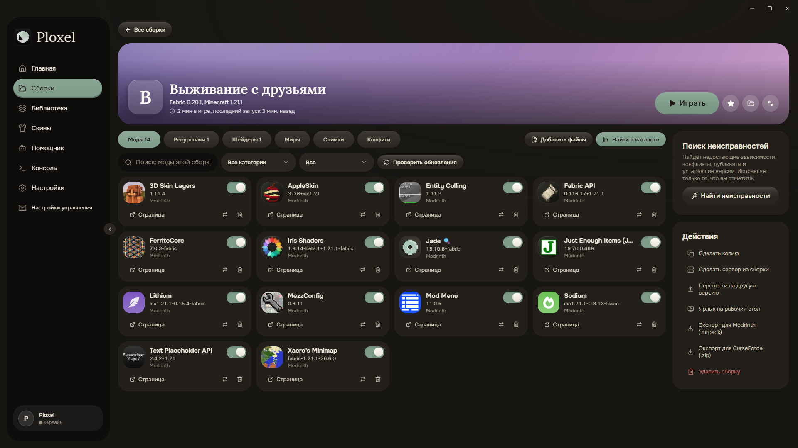</p>

- Вкладки «Моды», «Ресурспаки», «Шейдеры», «Миры», «Снимки» и «Конфиги». Моды можно включать, выключать, обновлять, удалять и переносить в другую сборку.
- **Обновления модов.** «Проверить обновления» ищет новые версии под эту сборку. Кнопка «Обновить до …» сначала показывает, что нового во всех версиях между вашей и новой.
- **«Миры»** — сохранения сборки: импорт, экспорт, вход в мир одной кнопкой и **датапаки** каждого мира.
- **«Снимки»** — скриншоты из игры с датой и миром.
- **«Конфиги»** — настройки модов и options.txt в редакторе прямо в лаунчере. Ошибки в JSON и TOML показываются до сохранения, прошлая версия файла сохраняется в резервную копию.
- **«Поиск неисправностей».** Находит недостающие зависимости, конфликты, один и тот же мод из Modrinth и CurseForge, моды не под ту версию игры или загрузчик. Отмеченное исправляется одной кнопкой.
- **«Улучшить с ИИ».** Опишите, чего не хватает, и ИИ предложит моды под вашу сборку.
- **Настройки сборки:** память с рекомендацией для этой сборки, Java, окно игры, обложка.

**Обновление модпака.** У сборки из модпака видна его версия и кнопка «Обновить до …». Лаунчер сравнивает старую и новую версии и меняет только то, что поменял автор:

<p align="center">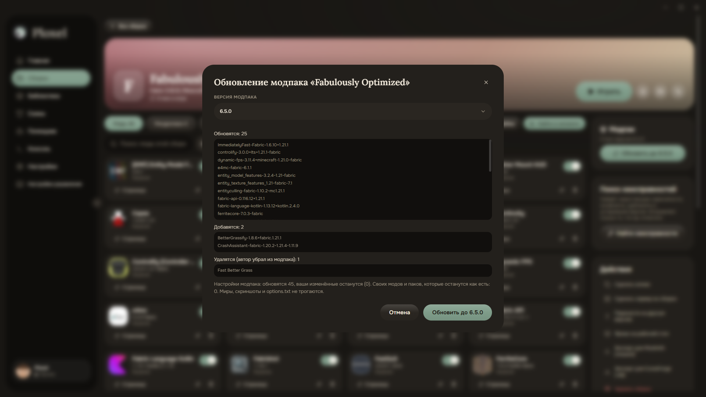</p>

- видно, какие моды обновятся, добавятся и удалятся;
- свои моды, миры, скриншоты, options.txt и настройки, которые вы меняли сами, остаются;
- заменённые файлы сохраняются в папке `backups` сборки.

**Перенос на другую версию игры.** Лаунчер ищет каждый мод под новую версию, показывает итог и делает копию сборки с обновлёнными модами. Исходная сборка не меняется:

<p align="center">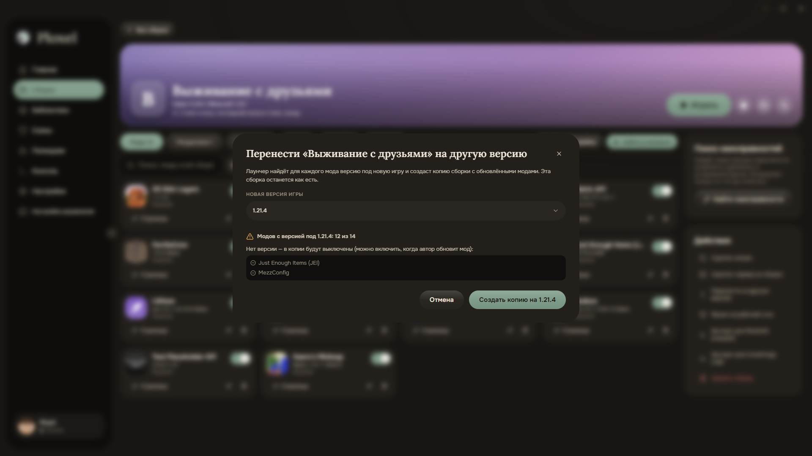</p>

**Сервер из сборки.** Отдельная сборка-сервер: серверный Minecraft, загрузчик и только те моды, которые нужны серверу. Моды только для игрока (Sodium, Iris, миникарты) лаунчер отсеивает сам. Мир можно взять из сборки. Сервер запускается кнопкой «Запустить сервер» в своём окне консоли:

<p align="center">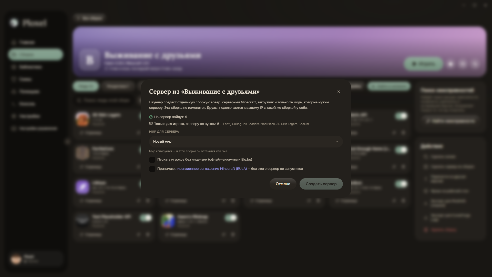</p>

**Ещё в «Действиях»:** копия сборки, ярлык на рабочий стол, экспорт для Modrinth (`.mrpack`) и CurseForge (`.zip`).

---

### Библиотека

<p align="center">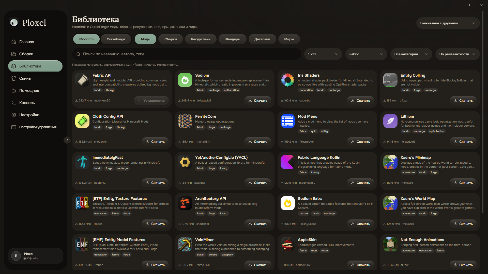</p>

Каталоги Modrinth и CurseForge внутри лаунчера. Переключатель каталога — вверху слева.

- **Типы проектов:** моды, модпаки, ресурспаки, шейдеры, датапаки и миры.
- **Фильтры:** версия игры, загрузчик, категория и сортировка. **Поиск** понимает русский язык, опечатки и транслит: «oruzhie» найдёт моды на оружие.
- **«Скачать».** Ставит проект в выбранную сборку вместе со всеми зависимостями. Модпак становится новой сборкой.
- **Миры с CurseForge** сами докачивают нужные им моды. Если моды есть только под другую версию игры, лаунчер сделает для мира подходящую сборку. Если миру нужен целый модпак, он поставится вместе с миром.
- **Файлы «только с сайта».** Если автор разрешил скачивать мод только с сайта CurseForge, лаунчер откроет страницу файла, сам найдёт скачанный файл в «Загрузках» и перенесёт его в сборку.
- **«Подобрать с ИИ».** Опишите, какую сборку хотите, и ИИ предложит моды, ресурспаки и шейдеры карточками. Вы снимете лишнее, и лаунчер соберёт сборку в фоне.

**Страница проекта** открывается кликом по карточке: описание с кнопкой «Перевод», галерея, все версии файла и зависимости. Справа — установка: сначала версия игры и файла, потом сборка, куда ставить.

<p align="center">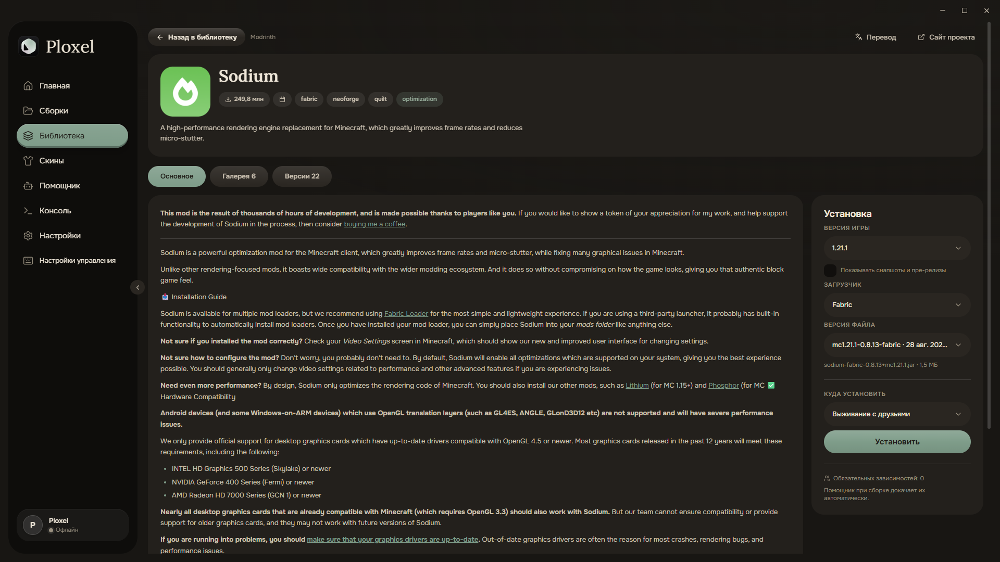</p>

---

### Скины

<p align="center">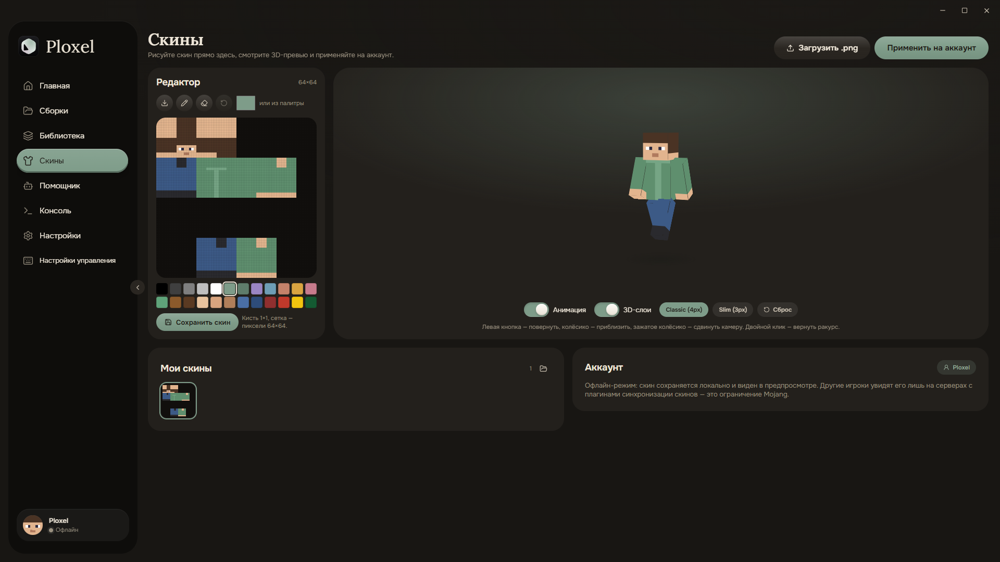</p>

Редактор скина и 3D-просмотр.

- **Редактор 64×64.** Кисть, ластик, палитра и свой цвет. «Сохранить скин» кладёт его в «Мои скины».
- **3D-просмотр:** анимация, объёмный второй слой (как в моде 3D Skin Layers), руки Classic (4 px) или Slim (3 px).
- **Камера:** левая кнопка мыши — повернуть, колёсико — приблизить, зажатое колёсико — сдвинуть, двойной клик — вернуть ракурс.
- **«Загрузить .png»** открывает готовый скин, **«Применить на аккаунт»** ставит его на аккаунт Microsoft.

---

### Помощник

<p align="center">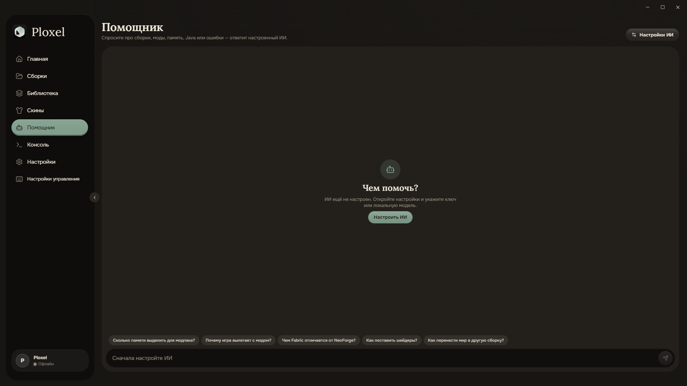</p>

Чат с ИИ о Minecraft: сборки, моды, память, Java, ошибки.

- Внизу — готовые вопросы, например «Сколько памяти выделить для модпака?».
- «Настройки ИИ» вверху справа ведут к подключению сервиса (см. «ИИ: что нужно знать»).
- Переписка хранится только на вашем компьютере.

---

### Консоль

<p align="center">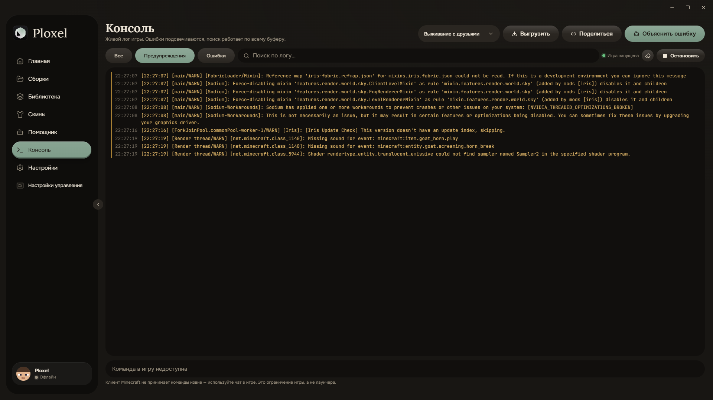</p>

Живой лог игры.

- **Подсветка.** Ошибки и предупреждения выделены цветом. Фильтры «Все», «Предупреждения», «Ошибки» и поиск по всему логу.
- **«Выгрузить».** Сохраняет лог в файл.
- **«Поделиться».** Загружает лог на mclo.gs и копирует короткую ссылку. Перед отправкой видно, что уйдёт: ник, папка пользователя и токены вырезаны.
- **«Объяснить ошибку».** ИИ объясняет простыми словами, почему игра упала и что делать. Лог перед отправкой очищается, и вы видите его до отправки.

---

### Настройки

<p align="center">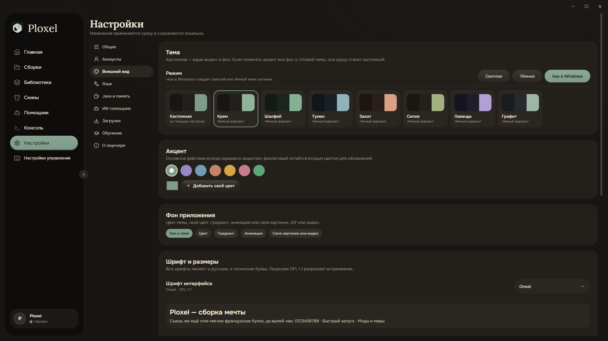</p>

Изменения применяются сразу и хранятся только на вашем компьютере. Разделы:

- **Общие:** папка данных и её перенос на другой диск, память по умолчанию, что делать с лаунчером при запуске игры (оставить, свернуть или закрыть — лаунчер дождётся конца игры в фоне), окно игры, статус в Discord, проверка обновлений.
- **Аккаунты.** Вход через Microsoft (по коду), через Ely.by или офлайн-режим. Несколько аккаунтов с быстрым переключением.
- **Внешний вид:** 7 тем со светлым и тёмным вариантом, своя тема и акцентный цвет, фон приложения (6 анимированных со своими цветами, градиент или своя картинка, GIF или видео), 12 шрифтов с кириллицей и латиницей, размеры, экспорт и импорт настроек.
- **Язык.** 13 языков интерфейса.
- **Java и память**, **ИИ-помощник**, **Загрузки** (куда скачивать, число загрузок, ограничение скорости), **Обучение**, **О лаунчере** (обновления, лицензии, полное удаление).

**Память для каждой сборки.** Лаунчер считает рекомендуемую память по модам сборки: оптимизация почти ничего не добавляет, контент и тяжёлые моды вроде Create — больше, сверху шейдеры, Distant Horizons и HD-ресурспаки. Галочками можно учитывать память компьютера и сколько её свободно прямо сейчас. Кнопка «Почему столько» показывает расчёт.

---

### Настройки управления

<p align="center">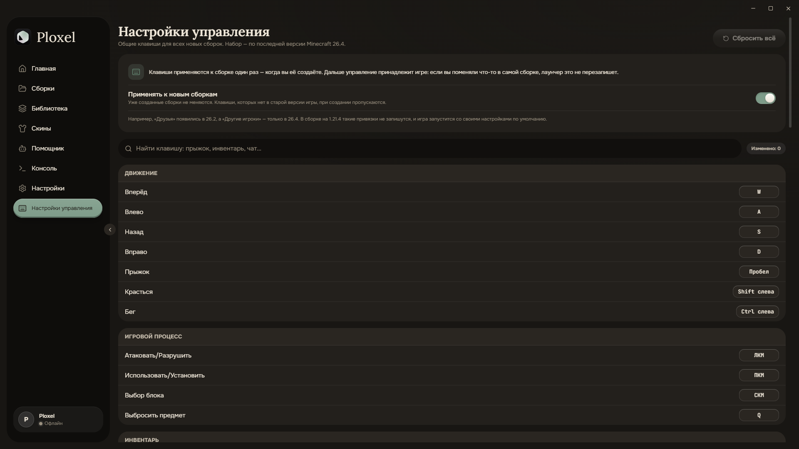</p>

Общий набор клавиш для всех новых сборок, чтобы не переназначать их в каждой.

- 63 привязки по последней версии Minecraft с официальными названиями.
- Поиск клавиши по названию и счётчик изменённых.
- Клавиши применяются один раз, при создании сборки. Дальше управление принадлежит игре: лаунчер его не перезапишет. Клавиши, которых нет в старой версии игры, пропускаются.

## ИИ: что нужно знать

Своего ИИ-сервиса у Ploxel нет: оплачивать запросы за всех пользователей я пока не могу. Подключите любой OpenAI-совместимый сервис в «Настройки → ИИ-помощник»:
- бесплатно и без интернета — локальная модель через **LM Studio** или **Ollama**;
- или облачный сервис (OpenAI, OpenRouter, Groq и др.) со своим ключом.

Ключ хранится только на вашем компьютере в зашифрованном виде (Windows DPAPI). Без ключа все остальные функции лаунчера работают как обычно.

## Приватность

- **Телеметрия.** Никакой телеметрии и аналитики.
- **Где хранятся данные.** Аккаунты, ключи и настройки хранятся только у вас (`%APPDATA%\Ploxel`).
- **Пароли.** Пароль Ely.by уходит только на сервер Ely.by и не сохраняется. Вход Microsoft идёт через сайт Microsoft.
- **Удаление.** «Настройки → О лаунчере → Удаление». Галочки «Также удалить мои сборки» и «Также удалить мои данные» стирают всё без следа.
- **Обновления.** Лаунчер ищет их только на этой странице GitHub и перед установкой сверяет SHA-256 скачанного установщика.
- **Откуда скачиваются файлы.** Только с официальных адресов: Mojang, Modrinth, CurseForge, серверы загрузчиков (Fabric, Forge, NeoForge, Quilt), Adoptium. Запрет автора мода на скачивание через лаунчеры не обходится: такие файлы скачиваются с сайта CurseForge вами.
- **Перевод.** Кнопка «Перевод» на странице мода отправляет в Google Translate только текст описания мода.
- **Лог по ссылке.** На mclo.gs уходит только тот очищенный текст, который вы видели в окне, и только по кнопке.
- **Discord.** Статус передаётся только программе Discord на вашем компьютере. Выключается в «Настройки → Общие».

## Частые вопросы

<details>
<summary><b>Чем Ploxel отличается от других лаунчеров?</b></summary>

Каждый лаунчер хорош по-своему. В Ploxel я постарался совместить простой и понятный интерфейс для новичка с инструментами, которые пригодятся и опытному игроку: обновление модпаков без переустановки, перенос сборки на новую версию игры, сервер из сборки, поиск неисправностей. Если для вас это важно — попробуйте.

</details>

<details>
<summary><b>Нужна ли лицензия Minecraft?</b></summary>

Для входа через Microsoft — да, нужен аккаунт с купленной игрой. Без него можно играть в офлайн-режиме или войти через Ely.by. Сетевая игра на серверах с проверкой лицензии в этом случае недоступна.

</details>

<details>
<summary><b>Как поиграть с друзьями?</b></summary>

Откройте сборку → «Действия» → «Сделать сервер из сборки». Лаунчер соберёт сервер с нужными модами, останется нажать «Запустить сервер». Друзья подключаются к вашему IP с такой же сборкой. Чтобы подключиться через интернет, на роутере нужен открытый порт 25565 или сервис вроде Radmin VPN / ZeroTier.

</details>

<details>
<summary><b>Сколько памяти выделять?</b></summary>

Столько, сколько лаунчер рекомендует в настройках сборки: он считает по вашим модам. «Побольше» — не всегда лучше: лишняя память удлиняет паузы на сборку мусора.

</details>

<details>
<summary><b>Игра не запускается или вылетает. Что делать?</b></summary>

1. Откройте сборку и нажмите «Поиск неисправностей»: он найдёт недостающие зависимости и конфликты.
2. Если не помогло, откройте «Консоль» → «Объяснить ошибку».
3. Подробнее — в гайдах на главной.

</details>

<details>
<summary><b>Можно ли перенести сборки из другого лаунчера?</b></summary>

Да. «Сборки» → «Импорт»: лаунчер сам найдёт сборки 16 лаунчеров на компьютере.

</details>

<details>
<summary><b>Он скопирован с других лаунчеров?</b></summary>

Нет. Часть идей подсмотрена у других лаунчеров, особенно у XMCL: подбор сборки с ИИ, гибкая настройка загрузок, импорт сборок, разбор ошибок и поиск неисправностей в сборке. Реализация своя.

</details>

<details>
<summary><b>Как он сделан?</b></summary>

Лаунчер написан при помощи Claude Opus 5.5. Ранние версии тестировали мои знакомые.

</details>

<details>
<summary><b>Он полностью готов?</b></summary>

Нет, ему ещё есть куда расти. Но основное работает: можно создать сборку, поставить моды, запустить игру и играть.

</details>

<details>
<summary><b>Где официальные версии?</b></summary>

Только на этой странице GitHub. В других местах выкладывать Ploxel я пока не планирую. Если встретите его где-то ещё, это не мой файл.

</details>

<details>
<summary><b>Лаунчер «чистый»?</b></summary>

Да. Весь исходный код открыт в этом репозитории, установщик собирается из него же. Контрольная сумма каждого установщика указана в описании релиза.

</details>

## Сборка из исходников

Нужен [Node.js 22+](https://nodejs.org).

```powershell
npm install    # зависимости (один раз)
npm run dev    # запуск в режиме разработки
npm run dist   # установщик — появится в dist\installer
```

Ключи API (Microsoft, CurseForge, ИИ) в код не встроены: они берутся из `config.json` рядом с приложением или из переменных окружения. Пример — в `config.example.json`.

## Лицензия

[MIT](LICENSE). Ploxel — неофициальный проект, он не связан с Mojang Studios и Microsoft. Minecraft — товарный знак Mojang Synergies AB.

---

<sub>Верификация на LibriumHub: LibVerif_1Ab123Nsx</sub>
