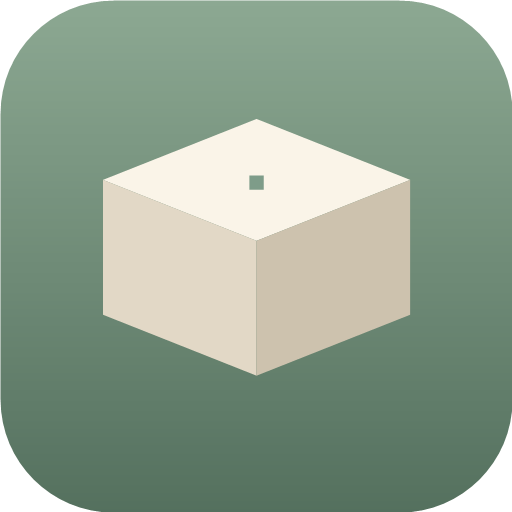
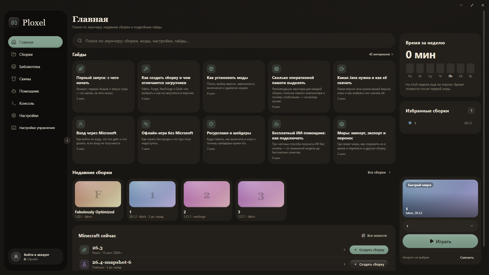
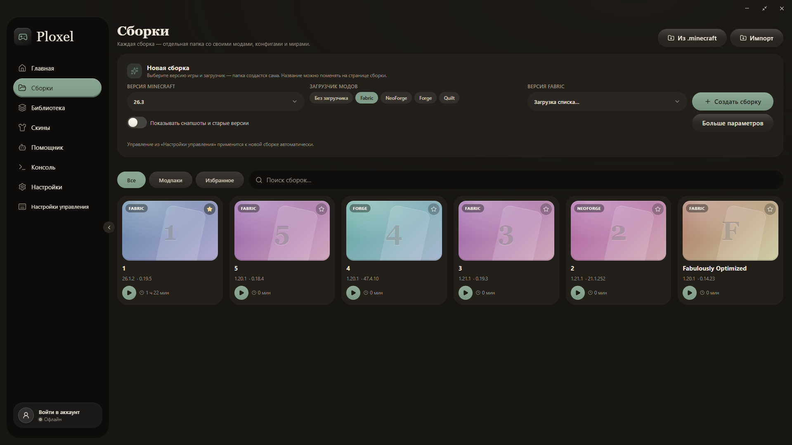
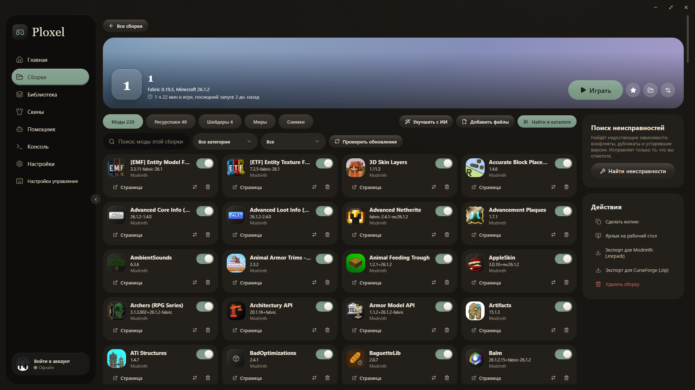
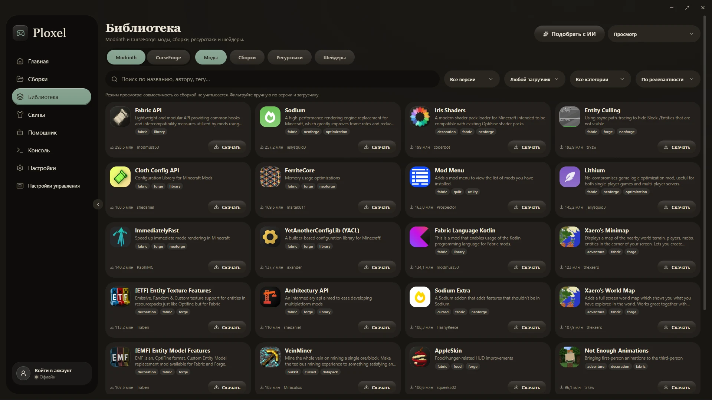
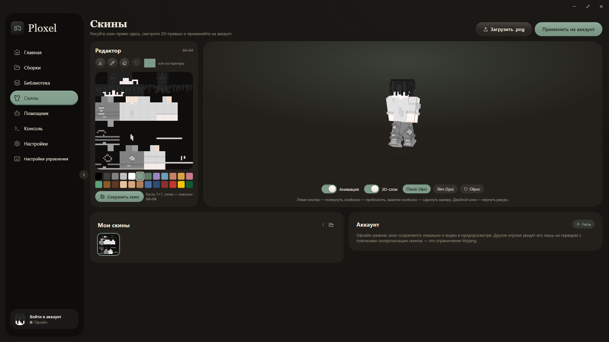
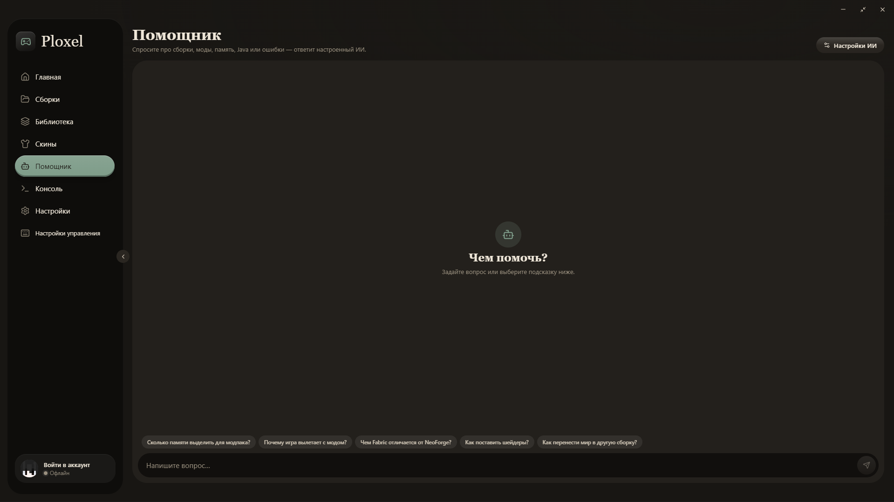
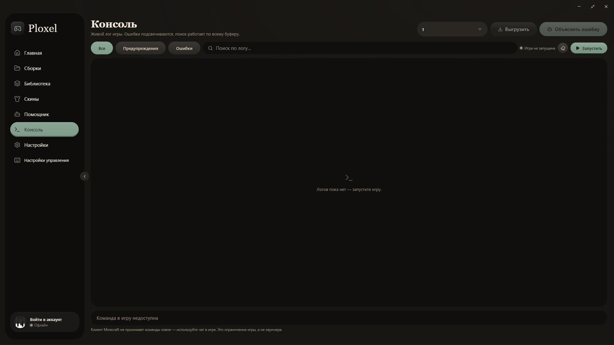
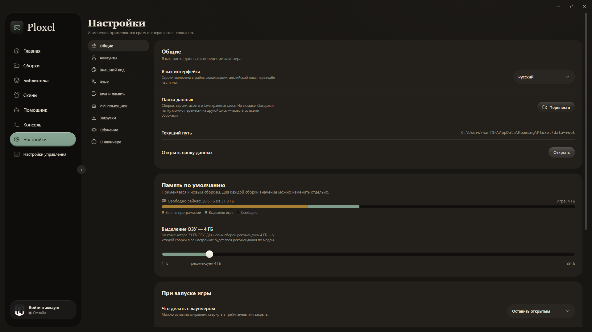
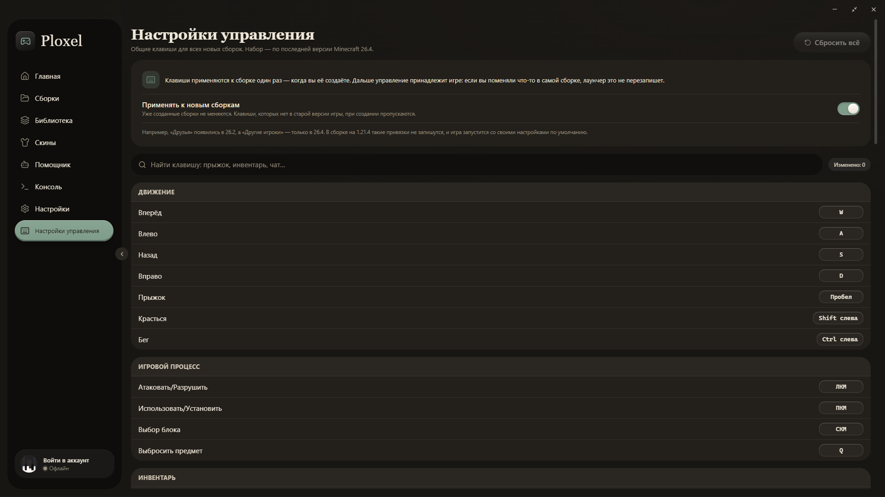

<div align="center">



# Ploxel

[](../../releases/latest)

[](LICENSE)

[Скачать](#скачать) · [Вкладки](#вкладки-лаунчера) · [ИИ](#ии-что-нужно-знать) · [Приватность](#приватность) · [Вопросы](#частые-вопросы) · [Сборка из исходников](#сборка-из-исходников)

</div>

---

**Ploxel — удобный и понятный лаунчер Minecraft: Java Edition, в котором есть всё нужное, чтобы гибко настроить игру под себя.** С первой минуты ясно, где что находится, а возможностей хватит и новичку, и опытному игроку.

Он создаёт и запускает сборки на любой версии игры с **Fabric, Forge, NeoForge или Quilt**. Моды, модпаки, ресурспаки и шейдеры ставятся из каталогов **Modrinth и CurseForge** прямо в лаунчере. Зависимости докачиваются сами, а «Поиск неисправностей» находит конфликты и дубликаты до того, как игра упадёт.

Ещё в Ploxel есть редактор скинов с 3D-просмотром и ИИ-помощник, который подбирает сборку и объясняет ошибки игры. Внешний вид лаунчера тоже меняется: темы, фоны, шрифты.

> [!NOTE]
> Рекламы, доната и телеметрии нет. Исходный код открыт.

<p align="center"></p>

## Скачать

Последняя версия — на странице [Releases](../../releases/latest): файл `Ploxel-Setup-<версия>.exe`.
Дальше лаунчер обновляется сам: при запуске он проверяет новые версии на этой странице и предлагает поставить их поверх. Сборки и настройки при этом сохраняются.

- **Система:** Windows 10/11, 64-bit.
- **Проверка файла:** в PowerShell выполните `Get-FileHash .\Ploxel-Setup-<версия>.exe` и сравните результат с SHA-256 из описания релиза.

> [!TIP]
> Установщик пока не подписан цифровой подписью, поэтому Windows SmartScreen может показать предупреждение. Нажмите «Подробнее» → «Выполнить в любом случае».

## Вкладки лаунчера

### Главная

Стартовая страница. Отсюда можно быстро запустить игру или найти что угодно в лаунчере.

- **Поиск по лаунчеру.** Ищет сборки, моды, настройки и гайды одновременно. Подсказки появляются, пока слово ещё не дописано. Поиск понимает:
  - опечатки;
  - перепутанную раскладку;
  - транслит («kak ustanovit shejdery»);
  - фразы своими словами («не запускается», «чёрный экран», «играть с другом»).
- **Гайды.** 42 подробных материала: от первого запуска до памяти, Java, шейдеров, входа в аккаунт и переноса миров. На главной видны самые нужные, остальные — по ссылке «42 материала».
- **Недавние сборки.** Сборки, в которые вы играли последними.
- **Minecraft сейчас.** Свежие релизы и снапшоты Mojang. Кнопка «Создать сборку» сразу делает сборку на этой версии.
- **Время за неделю.** Сколько вы играли в каждый день недели. Клик по дню показывает время и сборки за этот день.
- **Избранные сборки.** Сборки, отмеченные звёздочкой.
- **Быстрый запуск.** Выберите сборку и нажмите «Играть». Здесь же видно, под каким аккаунтом запустится игра, и кнопка «Сменить».

---

### Сборки

<p align="center"></p>

Каждая сборка — отдельная папка со своими модами, конфигами, мирами и настройками. Сборки не мешают друг другу.

- **Новая сборка в одном блоке.** Выберите версию игры и загрузчик (без загрузчика, Fabric, NeoForge, Forge или Quilt) и нажмите «Создать сборку». Снапшоты и старые версии включаются тумблером. Нужные загрузчик и Java лаунчер скачает сам при первом запуске.
- **«Больше параметров».** Название, память и своя Java для новой сборки.
- **Импорт.** Сборки переносятся из 16 лаунчеров: официального, Prism, MultiMC, CurseForge, Modrinth App, TLauncher, XMCL и других. Также можно открыть модпак `.mrpack` или CurseForge `.zip`. Кнопка «Из .minecraft» забирает моды и миры из обычной папки игры. После переноса лаунчер может удалить сборки в старом лаунчере: папки уходят в корзину Windows.
- **Фильтры и поиск.** «Все», «Модпаки», «Избранное» и поиск по названию.

**Страница сборки** открывается кликом по карточке:

<p align="center"></p>

- Вкладки «Моды», «Ресурспаки», «Шейдеры», «Миры» и «Снимки». Моды можно включать, выключать, обновлять, удалять и переносить в другую сборку.
- **«Снимки»** — скриншоты из игры с датой и миром. Их можно открыть на весь экран, сохранить или удалить.
- **«Поиск неисправностей».** Проверяет сборку на:
  - недостающие зависимости;
  - конфликты;
  - один и тот же мод из Modrinth и CurseForge;
  - моды не под ту версию игры или загрузчик.

  Найденное делится на «Ошибки», «Новые версии» и «Необязательные зависимости». Отмеченное исправляется одной кнопкой.
- **«Улучшить с ИИ».** Опишите, чего не хватает, и ИИ предложит моды под вашу сборку. Уже установленные он не повторяет.
- **Настройки сборки:**
  - память с рекомендацией именно для этой сборки (см. «Настройки»);
  - Java;
  - обложка.
- **Действия:**
  - ярлык на рабочий стол;
  - экспорт для Modrinth (`.mrpack`);
  - экспорт для CurseForge (`.zip`).

---

### Библиотека

<p align="center"></p>

Каталоги Modrinth и CurseForge внутри лаунчера. Переключатель каталога — вверху слева.

- **Типы проектов:** моды, сборки (модпаки), ресурспаки и шейдеры.
- **Фильтры:** версия игры, загрузчик, категория и сортировка.
- **Поиск** понимает русский язык, опечатки и транслит: «oruzhie» найдёт моды на оружие.
- **«Скачать».** Ставит проект в выбранную сборку вместе со всеми зависимостями. Модпак становится новой сборкой.
- **Список справа вверху.** Выбирает, куда ставить. В режиме «Просмотр» совместимость не проверяется, и файл просто скачивается.
- **Страница проекта** открывается кликом по карточке:
  - описание с кнопкой «Перевод»;
  - галерея картинок;
  - все версии файла;
  - зависимости.

  Если подходящей сборки нет, в «Куда установить» есть «Создать новую сборку».
- **«Подобрать с ИИ».** Опишите, какую сборку хотите, и выберите загрузчик, версию и количество модов. ИИ предложит моды, ресурспаки и шейдеры карточками. Вы снимете лишнее, и лаунчер соберёт сборку в фоне. Проекты, которых нет в каталогах, отбрасываются, а оптимизация под выбранную версию добавляется сама.

---

### Скины

<p align="center"></p>

Редактор скина и 3D-просмотр.

- **Редактор 64×64.** Кисть, ластик, палитра и свой цвет. «Сохранить скин» кладёт его в «Мои скины».
- **3D-просмотр:**
  - анимация;
  - объёмный второй слой (как в моде 3D Skin Layers);
  - вариант рук Classic (4 px) или Slim (3 px).

  Скин сам подстраивается под выбранный тип рук.
- **Управление камерой:**
  - левая кнопка мыши — повернуть;
  - колёсико — приблизить;
  - зажатое колёсико — сдвинуть камеру;
  - двойной клик — вернуть ракурс.
- **«Загрузить .png».** Открывает готовый скин из файла.
- **«Применить на аккаунт».** Ставит скин на аккаунт Microsoft. В офлайн-режиме скин виден только у вас и на серверах с плагинами синхронизации скинов. Это ограничение Mojang.

---

### Помощник

<p align="center"></p>

Чат с ИИ о Minecraft: сборки, моды, память, Java, ошибки.

- Внизу — готовые вопросы, например «Сколько памяти выделить для модпака?» или «Чем Fabric отличается от NeoForge?».
- «Настройки ИИ» вверху справа ведут к подключению сервиса (см. «ИИ: что нужно знать»).
- Переписка хранится только на вашем компьютере.

---

### Консоль

<p align="center"></p>

Живой лог игры.

- **Сборка.** Выбирается в списке вверху. Кнопка «Запустить» стартует её прямо отсюда.
- **Подсветка.** Ошибки и предупреждения выделены цветом.
- **Фильтры и поиск.** Фильтры «Все», «Предупреждения», «Ошибки» и поиск по всему логу.
- **«Выгрузить».** Сохраняет лог в файл.
- **«Объяснить ошибку».** Отправляет лог ИИ, и тот объясняет простыми словами, почему игра упала и что делать. Перед отправкой лог очищается от ника, путей и токенов, и вы видите его до отправки.

---

### Настройки

<p align="center"></p>

Изменения применяются сразу и хранятся только на вашем компьютере. Разделы:

- **Общие:**
  - язык;
  - папка данных и её перенос на другой диск вместе со всеми сборками;
  - память по умолчанию;
  - что делать с лаунчером при запуске игры: оставить, свернуть в трей или закрыть;
  - проверка обновлений;
  - сброс настроек.
- **Аккаунты.** Вход через Microsoft (по коду), через Ely.by или офлайн-режим. Несколько аккаунтов с быстрым переключением.
- **Внешний вид:**
  - 7 тем со светлым и тёмным вариантом, по умолчанию — «Как в Windows»;
  - своя «Кастомная» тема, акцентный цвет и градиенты;
  - фон приложения: 6 анимированных или свой — картинка, GIF или видео с затемнением;
  - 15 шрифтов, размеры и анимации;
  - экспорт и импорт настроек файлом.
- **Язык.** 13 языков интерфейса.
- **Java и память:**
  - автоматическое скачивание нужной Java или своя Java;
  - аргументы JVM.
- **ИИ-помощник.** Адрес сервиса, модель и ключ, быстрые настройки для популярных сервисов.
- **Загрузки:**
  - куда скачивать;
  - число одновременных загрузок;
  - ограничение скорости;
  - потоки на крупный файл.
- **Обучение.** Режим обучения при первом запуске: базовый, подробный или «не нужно».
- **О лаунчере.** Версия, обновления, благодарности и лицензии, полное удаление.

**Память для каждой сборки.** Лаунчер считает рекомендуемую память по модам, которые стоят в сборке:
- **основа:** версия игры и загрузчик;
- **моды:** оптимизация почти ничего не добавляет, мелкие улучшения — немного, контент и тяжёлые моды вроде Create — больше;
- **сверху:** шейдеры, Distant Horizons и HD-ресурспаки.

Например, пустая Fabric — 3 ГБ, 50 модов оптимизации и удобства — 6 ГБ. Кнопка «Почему столько» показывает расчёт. Больше, чем можно отдать без вреда системе, лаунчер не советует. Полоска над ползунком показывает, сколько памяти занято программами, сколько выделено игре и сколько свободно.

---

### Настройки управления

<p align="center"></p>

Общий набор клавиш для всех новых сборок, чтобы не переназначать их в каждой.

- 63 привязки по последней версии Minecraft с официальными названиями: движение, игровой процесс, инвентарь, чат и другие.
- Поиск клавиши по названию («прыжок», «инвентарь», «чат») и счётчик изменённых.
- **Когда применяются клавиши.** Один раз, при создании сборки. Дальше управление принадлежит игре: если вы поменяли что-то в самой сборке, лаунчер это не перезапишет.
- **Старые версии игры.** Клавиши, которых там ещё нет, пропускаются.
- **Сброс.** «Сбросить всё» возвращает стандартные клавиши.

## ИИ: что нужно знать

Своего ИИ-сервиса у Ploxel нет: оплачивать запросы за всех пользователей я пока не могу. Подключите любой OpenAI-совместимый сервис в «Настройки → ИИ-помощник»:
- бесплатно и без интернета — локальная модель через **LM Studio** или **Ollama**;
- или облачный сервис (OpenAI, OpenRouter, Groq и др.) со своим ключом.

Ключ хранится только на вашем компьютере в зашифрованном виде (Windows DPAPI). Без ключа все остальные функции лаунчера работают как обычно.

## Приватность

- **Телеметрия.** Никакой телеметрии и аналитики.
- **Где хранятся данные.** Аккаунты, ключи и настройки хранятся только у вас (`%APPDATA%\Ploxel`).
- **Пароли.** Пароль Ely.by уходит только на сервер Ely.by и не сохраняется. Вход Microsoft идёт через сайт Microsoft.
- **Удаление.** «Настройки → О лаунчере → Удаление». Галочки «Также удалить мои сборки» и «Также удалить мои данные» стирают всё без следа. Обычное удаление оставляет данные на случай переустановки.
- **Обновления.** Лаунчер ищет их только на этой странице GitHub и перед установкой сверяет SHA-256 скачанного установщика.
- **Откуда скачиваются файлы.** Только с официальных адресов: Mojang, Modrinth, CurseForge, серверы загрузчиков (Fabric, Forge, NeoForge, Quilt), Adoptium.
- **Перевод.** Кнопка «Перевод» на странице мода отправляет в Google Translate только текст описания мода.

## Частые вопросы

<details>
<summary><b>Чем Ploxel отличается от других лаунчеров?</b></summary>

Каждый лаунчер хорош по-своему. В Ploxel я постарался совместить простой и понятный интерфейс для новичка с инструментами, которые пригодятся и опытному игроку. Если для вас это важно — попробуйте.

</details>

<details>
<summary><b>Нужна ли лицензия Minecraft?</b></summary>

Для входа через Microsoft — да, нужен аккаунт с купленной игрой. Без него можно играть в офлайн-режиме или войти через Ely.by. Сетевая игра на серверах с проверкой лицензии в этом случае недоступна.

</details>

<details>
<summary><b>Сколько памяти выделять?</b></summary>

Столько, сколько лаунчер рекомендует в настройках сборки: он считает по вашим модам. «Побольше» — не всегда лучше: лишняя память удлиняет паузы на сборку мусора.

</details>

<details>
<summary><b>Игра не запускается или вылетает. Что делать?</b></summary>

1. Откройте сборку и нажмите «Поиск неисправностей»: он найдёт недостающие зависимости и конфликты.
2. Если не помогло, откройте «Консоль» → «Объяснить ошибку».
3. Подробнее — в гайдах на главной.

</details>

<details>
<summary><b>Можно ли перенести сборки из другого лаунчера?</b></summary>

Да. «Сборки» → «Импорт»: лаунчер сам найдёт сборки 16 лаунчеров на компьютере.

</details>

<details>
<summary><b>Он скопирован с других лаунчеров?</b></summary>

Нет. Часть идей подсмотрена у других лаунчеров, особенно у XMCL: подбор сборки с ИИ, гибкая настройка загрузок, импорт сборок, разбор ошибок и поиск неисправностей в сборке. Реализация своя.

</details>

<details>
<summary><b>Как он сделан?</b></summary>

Лаунчер написан при помощи Claude Opus 5.5. Ранние версии тестировали мои знакомые.

</details>

<details>
<summary><b>Он полностью готов?</b></summary>

Нет, ему ещё есть куда расти. Но основное работает: можно создать сборку, поставить моды, запустить игру и играть.

</details>

<details>
<summary><b>Где официальные версии?</b></summary>

Только на этой странице GitHub. В других местах выкладывать Ploxel я пока не планирую. Если встретите его где-то ещё, это не мой файл.

</details>

<details>
<summary><b>Лаунчер «чистый»?</b></summary>

Да. Весь исходный код открыт в этом репозитории, установщик собирается из него же. Контрольная сумма каждого установщика указана в описании релиза.

</details>

## Сборка из исходников

Нужен [Node.js 22+](https://nodejs.org).

```powershell
npm install    # зависимости (один раз)
npm run dev    # запуск в режиме разработки
npm run dist   # установщик — появится в dist\installer
```

Ключи API (Microsoft, CurseForge, ИИ) в код не встроены: они берутся из `config.json` рядом с приложением или из переменных окружения. Пример — в `config.example.json`.

## Лицензия

[MIT](LICENSE). Ploxel — неофициальный проект, он не связан с Mojang Studios и Microsoft. Minecraft — товарный знак Mojang Synergies AB.
